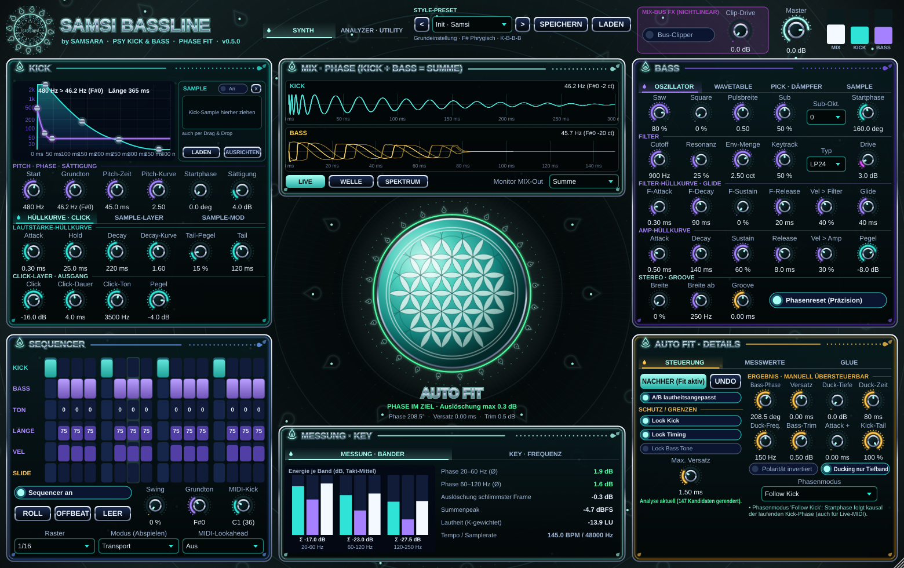
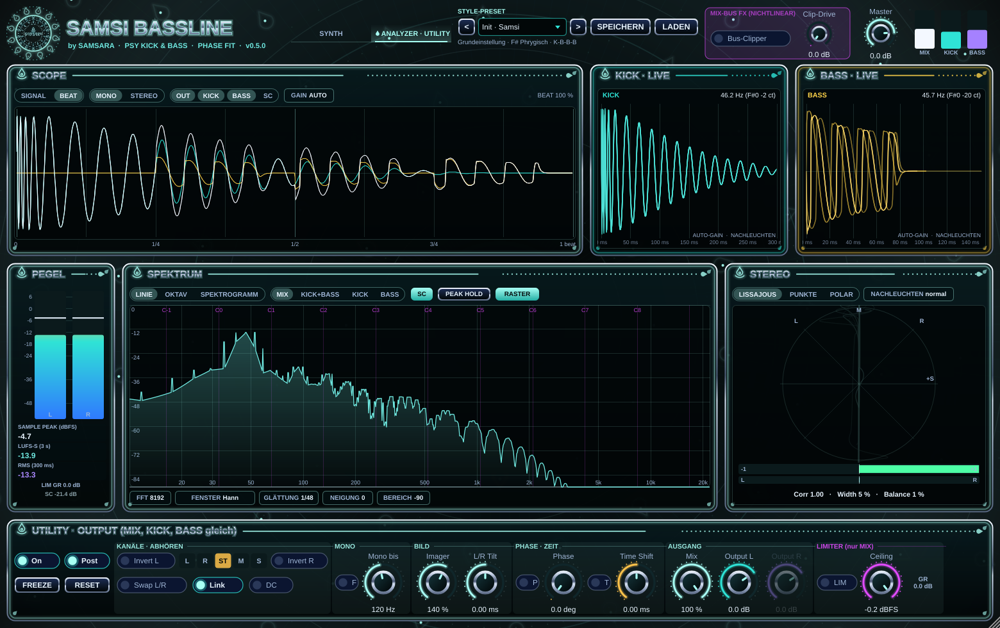
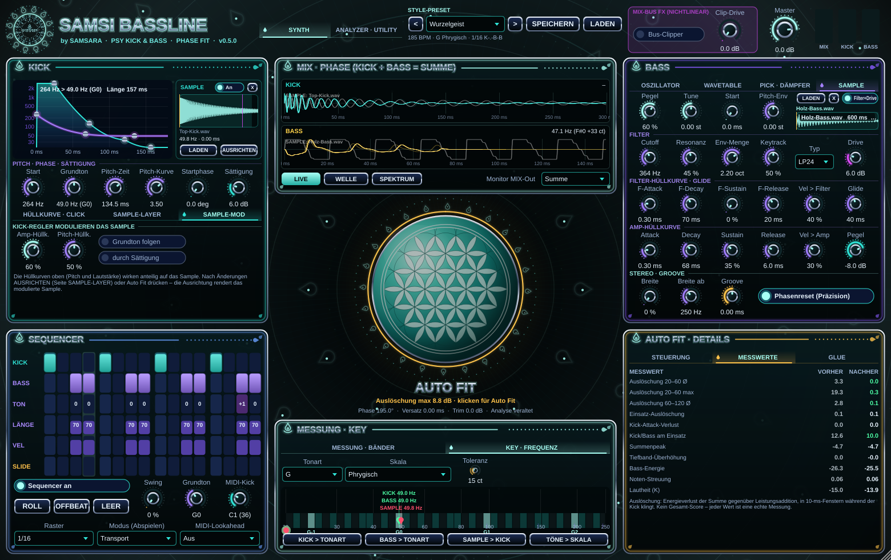
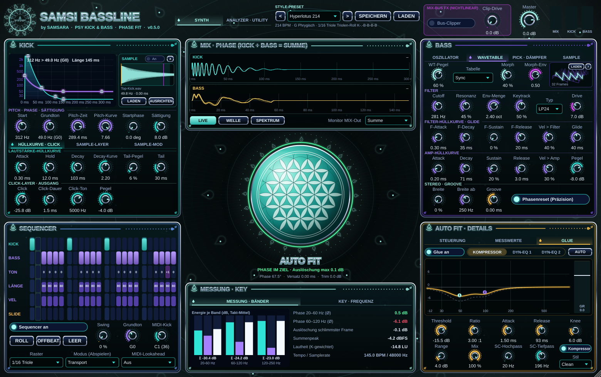

# Samsi Bassline – Psytrance Kick & Bass Synthesizer mit Auto Fit

VST3-Instrument by **SAMSARA** für Ableton Live 12, Cubase, Bitwig Studio und FL Studio
(Windows x64, macOS Apple Silicon + Intel). Erzeugt Kick und Bass auf **einer gemeinsamen,
samplegenauen Zeitbasis**, stimmt beide mit **Auto Fit** messbar aufeinander ab und prüft in der
**Key-Ansicht**, ob Kick, Bass, Pattern und Samples in derselben Tonart liegen.
Drei Ausgänge: **MIX**, **KICK**, **BASS** – zum getrennten Bearbeiten und Exportieren.









**Neu in 0.5.0 (Teil 2):**
* **Kick→Bass-Glue** (AUTO FIT · DETAILS › GLUE): Sidechain-Kompressor (Threshold, Ratio, Attack, Release, Knee, Range,
  Sidechain-Hoch-/Tiefpass, Mix, Stil Clean/Pumping) und **zwei dynamische EQ-Bänder** (Glocke/Low-Shelf, Frequenz, Q,
  Range ±24 dB, Threshold, Attack, Release) auf dem Bass – ausgelöst von der Kick derselben Instanz, sample-genau ohne
  Latenz. Kurve zeigt Ziel (gestrichelt) und momentane Absenkung, Balken die Kompressor-Reduktion. **AUTO** richtet
  Startwerte aus dem Klang ein (Bänder auf Kick-Grundton und 1. Oberton, Thresholds relativ zum gemessenen Kick-Pegel,
  Release passend zum Tempo). Auto Fit misst inklusive Glue.
* **Sample-Fenster im KICK-Bereich** (rechts neben der Hüllkurve, immer sichtbar – wie das Sample-/Wavetable-Fenster
  auf der Bass-Seite): Wellenform mit Start-/Längen-Markern, Name, Grundton, aktuelle Ausrichtung (Versatz, Polarität),
  Schalter An, LADEN, X, AUSRICHTEN; Dateien können auf den ganzen KICK-Bereich gezogen werden.
* **Eigene Samples in die LIVE-Wellenformen ziehen** (Synth- und Analyzer-Ansicht): Kick-Sample wird geladen und sofort
  phasen-ausgerichtet, Bass-Sample geladen und pro Note gestimmt; danach startet Auto Fit (abschaltbar). Rechtsklick-Menü:
  Laden, Entfernen, Ausrichten, Auto Fit. Das geladene Sample wird als graue Referenz über dem Live-Mitschnitt gezeigt.
* **Samples mit den Reglern modulieren:** Kick › SAMPLE-MOD: Amp-Hüllkurve und Pitch-Hüllkurve der Kick wirken anteilig
  auf das Sample, „Grundton folgen“ stimmt es auf den Kick-Grundton, „durch Sättigung“ schickt es durch den Kick-Drive.
  Bass › SAMPLE: „Filter+Drive“ (Sample durch Pick, Dämpfer, Filter, Drive – oder nur Amp-Hüllkurve) und Pitch-Env
  (Filter-Hüllkurve verstimmt das Sample ±24 Halbtöne). Die Kick-Ausrichtung rendert dabei das *modulierte* Sample.

**Neu in 0.5.0:**
* **LIVE-Wellenformen von Kick und Bass** (Mitte oben, Knopf LIVE – Standard): jeder Kick und jede Bassnote wird
  während der Wiedergabe ab ihrem Start mitgeschnitten und als eigene Wellenform gezeigt, mit Nachleuchten der
  vorherigen Schläge. Dreht man an einem Regler, sieht man sofort, wie sich die Form ändert. Dazu Grundton,
  Länge und Pegel jedes Schlags/jeder Note.
* **Zweite Ansicht „ANALYZER · UTILITY“** (Umschalter im Kopf) mit Funktionen, wie man sie von Mess-Utilities kennt –
  **selbst geschrieben**, siehe Abschnitt 4c: Scope mit Signal- und Beat-Modus, Spektrum (Linie/Oktavbänder) und
  Spektrogramm (horizontal/vertikal, 6 Paletten), musikalisches Raster, Goniometer mit Korrelation/Breite/Balance,
  L/R-Meter mit Sample-/True-Peak, LUFS S/M/I, RMS/Crest, Freeze – und die Ausgangs-Utility: Invert L/R, Swap,
  Abhören L/R/ST/M/S (+Dual-Mono), DC-Sperre, Mono-Filter, Imager, L/R-Tilt, Phasendrehung, Time Shift (±50 ms),
  Mix, Output L/R mit Link, Limiter.
* **Sidechain-Eingang** (nur Anzeige, verändert den Klang nie): z. B. die Kick oder ein Referenztrack einer anderen
  Spur als graue Kurve in Scope, Spektrum und Goniometer, plus **Tempo-Erkennung** des Sidechain-Signals.

**Neu in 0.4.0:**
* **Auto-Fit-Orb in der Mitte:** eine prozedural gezeichnete *Blume des Lebens* (Mint/Türkis-Kugel mit weißen
  Blütenblättern) ist der Auto-Fit-Knopf – beliebig oft klickbar, mit Fortschrittsring. Sie **pulsiert im Takt der
  Kick, sobald die Messung im Ziel liegt** (schlimmste Auslöschung 20–60 Hz unter 3 dB, Tonart-Prüfung grün,
  Fit aktiv). Die Oberfläche ist radial darum angeordnet (1560 × 980, stufenlos skalierbar).
* **25 neue Presets aus deinen 6 Referenztracks abgeleitet und gemessen** (8 Themen: Industrial, Psy-Fi Dark,
  Futuristic, Alien, Biomech, Holzig, Future, High Tech) – alle 25 liegen bei allen sechs Messgrößen im Zielbereich
  und starten bereits Auto-Fit-abgestimmt. Messbericht: [docs/PRESETS.md](docs/PRESETS.md).
* **Eigene Samples für Kick und Bass**: Kick-Sample wird beim Laden, per **AUSRICHTEN** und bei jedem Auto Fit
  automatisch phasenausgerichtet (Zeitversatz ±10 ms + Polarität, Tiefband-Korrelation). Neues **Bass-Sample**
  (Seite SAMPLE): Grundton wird erkannt, das Sample wird pro Note gestimmt und mit derselben Startphase wie
  der Oszillator gestartet – Auto Fit stimmt es so mit ab.
* **Sequencer-Raster** 1/16, **1/16-Triole** (rollender Galopp, 24 Schritte) und **1/32** (32 Schritte);
  ROLL/OFFBEAT erzeugen passende Grundmuster für jedes Raster.

**Neu in 0.3.0:** Kick-Sample-Layer (eigene Samples per Drag & Drop), Wavetable-Bass mit Morphing
(6 eingebaute Tabellen + eigene Dateien), Pick/Dämpfer-Zupfmodell, Key-/Frequenz-Ansicht mit
Rot-Markierung und Korrektur-Knöpfen, 7 Style-Presets + eigene Presets, MIDI-Gate-Modus
(eine durchgehende Note spielt das Pattern), Lookahead für Live-MIDI, Design im SAMSARA-Logo-Stil.

---

## 1. Werkzeuge, Versionen, Lizenzen

| Werkzeug | Version (geprüft) | Zweck |
|---|---|---|
| JUCE | **9.0.4** (neueste Version, wird automatisch geladen) | Plugin-Framework |
| CMake | ≥ 3.22 | Build-System |
| Windows | Visual Studio 2022 oder neuer, Workload „Desktopentwicklung mit C++“; Git für Windows | Compiler |
| macOS | Xcode (≥ 12.4 laut JUCE) bzw. Command Line Tools | Compiler, Universal Binary arm64 + x86_64 |
| Steinberg VST3 SDK | 3.8 (in JUCE enthalten) | VST3-Format |

**Lizenzen – wichtig für den späteren Verkauf**

* **JUCE** ist doppelt lizenziert: **AGPLv3** oder **kommerzielle JUCE-Lizenz**.
  Unter AGPLv3 müsste der vollständige Quellcode des Plugins offengelegt werden. Für einen Verkauf
  mit geschlossenem Quellcode ist eine **kommerzielle JUCE-Lizenz nötig** (Details: juce.com/get-juce).
  Das ist keine Rechtsberatung.
* **VST3 SDK** (Steinberg): MIT-Lizenz (seit SDK 3.8). Das VST-Logo hat eigene Nutzungsrichtlinien
  (`VST3_Usage_Guidelines.pdf` im SDK).
* Klangreferenzen (Vital, VB-1, KICK 2/3): Es wurden **keine** Oberflächen, Samples, Presets oder
  Algorithmen dieser Produkte übernommen. Alle Algorithmen sind Standardverfahren der Fachliteratur
  (siehe unten) und eigenständig implementiert.

---

## 2. Architektur und Signalfluss

```
 Host (BPM, Play, Position)──┐
 MIDI-Eingang ───────────────┼──► Ereignisliste (samplegenau, sortiert, feste Kapazität)
 interner 16-Step-Sequencer ─┘                │
                                              ▼
                                   SamsiEngine (eine Zeitbasis)
          ┌───────────────────────────────────┴───────────────────────────────────┐
     KickEngine                                                              BassEngine (monophon)
  Sinus (double-Phase)                                                  Saw + Pulse (PolyBLEP) + Sinus-Sub
  Pitch-Sweep log-Frequenz                                              Phasenreset pro Note (Startphase)
  Amp: Attack-Hold-Decay-Tail                                           TPT-SVF Tiefpass 12/24 dB + Resonanz
  Click-Layer (Rauschen→Bandpass)                                       Filter-Hüllkurve, Keytracking, Velocity
  Sättigung (ADAA-tanh)                                                 Drive (ADAA-tanh), Amp-Hüllkurve, Glide
          │                                                             Polarität, Trim, Ducking (Tiefband)
          │                                                             Pegel, Breite nur oberhalb X Hz
          ▼                                                                       ▼
   KICK-Ausgang (Stereo) ─────────────────► MIX = KICK + BASS ◄──────────── BASS-Ausgang (Stereo)
                                               │
                                     [optional: MIX-Bus-Clipper, NICHTLINEAR, Standard AUS]

 Hintergrund-Thread (nie im Audio-Thread):
   Vorschau-Rendering für die Anzeige  +  Auto Fit (rendert Kandidaten mit derselben Engine)
```

**Echtzeit-Regeln** (im Code durchgesetzt): Im Audio-Thread keine Speicherallokation (alle Puffer in
`prepareToPlay`), keine Sperren, keine Datei- oder GUI-Zugriffe. Parameter werden über
`std::atomic<float>` gelesen, das Pattern über 16 atomare 32-Bit-Worte. Auto-Fit-Ergebnisse werden im
Message-Thread als normale Parameteränderungen übernommen.

**Latenz:** standardmäßig 0 Samples. Statt Oversampling wird für die Sättigung
Antiderivative-Antialiasing (ADAA, Parker et al., DAFx 2016) verwendet; das spart Latenz und hält
MIX/KICK/BASS automatisch zeitgleich. Nur wenn **MIDI-Lookahead** eingeschaltet ist (5/10/20 ms), wird
genau diese Zeit als Latenz an den Host gemeldet und von ihm ausgeglichen (siehe Abschnitt 3).

**Samples und Wavetables im Audio-Thread:** Geladen und umgerechnet wird ausschließlich im
Message-Thread. Der Audio-Thread liest nur einen atomaren Zeiger auf unveränderliche Daten. Alte Daten
werden erst freigegeben, wenn danach mindestens zwei Audioblöcke vollständig verarbeitet wurden
(getestet mit 34 Wechseln während der Wiedergabe). Beide werden im Projekt eingebettet gespeichert –
ein Ableton-Set bleibt auf jedem Rechner vollständig.

### Klangerzeugung kurz erklärt

**Kick:** Ein Sinus-Oszillator mit doppelt genauer Phase. Die Frequenz läuft von *Start* nach *Grundton*
nach `f(t) = f_end · (f_start/f_end)^((1−t/T)^Kurve)` – also im logarithmischen Frequenzbereich, wie
das Ohr Tonhöhe wahrnimmt. Die Lautstärke folgt Attack → Hold → Decay (mit Kurve bis zum Tail-Pegel) →
Tail (bis 0). Der Click ist deterministisches Rauschen (fester Startwert) durch einen Bandpass mit
schnellem exponentiellem Abklingen. Alle Werte werden beim Anschlag eingefroren: jeder Schlag ist
identisch und reproduzierbar. Ein neuer Schlag blendet den alten in 1,5 ms aus (kein Knacken).

**Bass:** Fallender Sägezahn, Pulse und Sinus-Sub – alle so definiert, dass ihre Grundwelle phasengleich
ist (sonst würden Saw und Sub sich gegenseitig auslöschen). Bandbegrenzung durch PolyBLEP. Im
Präzisionsmodus (Standard) startet jede Note mit exakt derselben Oszillatorphase; ohne Präzisionsmodus
läuft die Phase frei weiter – aber nie zufällig. Das Filter ist ein Zustandsvariablen-Filter in
TPT-Struktur (stabil auch bei sehr schnellen Hüllkurven). Neue Noten blenden die alte in 2 ms aus,
dadurch erzeugt der Phasenreset kein Knacken. Die Stereobreite nutzt nur ein hochpassgefiltertes,
leicht verzögertes Seitensignal: `L = x + S`, `R = x − S`. Die Mono-Summe bleibt dadurch exakt
unverändert, der Sub bleibt mono.

**Kick-Sample-Layer:** Das Sample wird beim Kick-Anschlag mit eigener Verzögerung (0–30 ms),
Startpunkt, Stimmung (±24 Halbtöne, kubische Interpolation), Haltezeit, Ausblendzeit und Hochpass
(„Low-Cut“, 12 dB/Okt. x 2) abgespielt. Es wird **nach** der Kick-Sättigung addiert, bleibt also
unverfälscht. Typisch für Psytrance: Top/Click aus dem Sample, Sub/Body vom Synth – dafür den Low-Cut
des Samples auf 150–300 Hz stellen. Der Grundton des Samples wird automatisch erkannt
(NSDF-Verfahren nach McLeod) und in der Key-Ansicht angezeigt.

**Wavetable-Oszillator:** läuft auf derselben Phase wie Saw/Square/Sub (Phasenreset und Startphase gelten
mit). Jede Tabelle hat 9 Mip-Stufen mit 400 … 1 Obertönen; je nach Notenfrequenz wird die Stufe gewählt,
deren höchster Oberton unter 0,45 x Samplerate bleibt → kein Aliasing (getestet: Energie über der Grenze
≈ 10⁻¹⁵). **Morph** blendet zwischen den Frames, **Morph-Env** bewegt die Position mit der
Filter-Hüllkurve (animierter, „sprechender“ Bass). Eingebaut (eigene Entwürfe): Klassik (Saw → Square →
Puls), Holz (wandernder Formant, hohl), Flüstern (luftiges Obertonband), Sync, FM-Growl, Fold.

**Pick und Dämpfer** (Konzept inspiriert von virtuellen Zupfbässen wie Steinbergs VB-1, eigene
Umsetzung): *Anschlag* ist ein Kammfilter mit Verzögerung = Position x Periodendauer – er setzt
Kerben bei Obertönen, wie das Zupfen an einer bestimmten Stelle der Saite. *Dämpfer* ist ein
Tiefpass, dessen Grenzfrequenz nach dem Anschlag abfällt: die Höhen klingen schneller ab
(gemessen: −11 dB Höhenenergie 200–300 ms nach Anschlag bei Dämpfer 100 %).

**Glättung:** Pegel, Master, Trim und A/B-Ausgleich mit 25-ms-dB-Rampen; Drive, Breite und Polarität
linear (die Polaritätsumkehr läuft durch 0 statt zu springen). Filter-Cutoff wird über die
Hüllkurven-Steuerrate (alle 4 Samples) nachgeführt.

**Sicherheit:** Alle Werte werden auf gültige Bereiche begrenzt, NaN/Inf durch Standardwerte ersetzt.
Tritt dennoch ein ungültiger Wert am Ausgang auf, wird der Block stummgeschaltet und die Engine
zurückgesetzt – der Host erhält nie NaN.

---

## 3. Spielen: drei Modi – in jeder DAW gleich

| Modus (Sequencer-Bereich) | So spielst du | Gut für |
|---|---|---|
| **Transport** (Standard) | Plugin auf eine Instrumentenspur, **Play** drücken. Kein MIDI nötig. Pattern läuft synchron zu Tempo und Position. | schnelles Arbeiten, Loop-basiert |
| **MIDI-Gate** | **Eine durchgehende MIDI-Note** (beliebige Tonhöhe, außer der Kick-Note) startet das Pattern bei Schritt 1 und hält es; Note-Ende stoppt. Läuft der Host, bleibt das Pattern auf seinem Raster. | Arrangement: Pattern nur dort, wo Noten liegen |
| **MIDI-Gate + Transpose** | wie Gate, zusätzlich bestimmt die **Tonhöhe der Note den Bass-Grundton** (Oktave egal, die Oktave kommt vom Grundton-Regler). F gehalten → Bass in F, dann G → Bass in G. | Basslinien-Harmonie mit wenigen langen Noten |

Zusätzlich gilt in **jedem** Modus: MIDI-Note **36** löst die Kick aus. Im Transport-Modus spielt jede
andere Note direkt den Bass (Sequencer ausschalten, wenn du alles per MIDI schreiben willst).

**Notennamen:** MIDI 36 heißt in Ableton, Cubase und Bitwig **C1**, in FL Studio **C3**. Gemeint ist
immer dieselbe Taste. Die Kick-Note lässt sich mit „MIDI-Kick“ umstellen.

| MIDI | Wirkung (Transport-Modus) |
|---|---|
| Note 36 (einstellbar) | Kick (Velocity → Pegel), Note-Off wird ignoriert |
| jede andere Note | Bass (monophon, letzte Note hat Vorrang) |
| überlappende Bassnoten | gebunden (Slide mit der Glide-Zeit), kein Retrigger |
| Note-Off | Release; bei noch gehaltenen Noten Rückkehr zur zuletzt gehaltenen |

**Sequencer-Details:** 16 Sechzehntel, Muster **K-B-B-B** voreingestellt. Pro Schritt: Kick, Bass,
Tonhöhe (−24…+24), Länge (10–400 %), Velocity, Slide. Swing verschiebt ungerade Sechzehntel, Groove
verschiebt die Bass-Lane um −10…+10 ms; Kick-Zeitpunkte bleiben immer fest. Jeder Ereigniszeitpunkt wird
aus der Host-Position berechnet und auf das erste Sample danach gelegt → **bitgleich bei jeder
Blockgröße** (getestet). Loop-Sprünge, Transport-Neustarts und Tempowechsel werden erkannt.
Töne außerhalb der eingestellten Tonart werden in der TON-Zeile **rot** markiert.

**MIDI-Lookahead (Aus / 5 / 10 / 20 ms):** Bei Live-MIDI kennt das Plugin keine zukünftigen Noten.
Mit Lookahead wird alles um diese Zeit verzögert und dem Host als Latenz gemeldet; der Host gleicht
das automatisch aus (Ableton, Cubase, Bitwig und FL Studio haben Latenzausgleich). Dadurch kann
Auto Fit den Bass bei Live-MIDI auch **früher** setzen (negativer Versatz bis zur Lookahead-Zeit).
Ohne Lookahead wird ein negativer Versatz bei Live-MIDI auf 0 begrenzt. Der Parameter ist absichtlich
nicht automatisierbar (eine Latenzänderung während der Wiedergabe würde Aussetzer verursachen).
Zum Live-Einspielen mit Keyboard „Aus“ lassen.

---

## 4. Auto Fit – was es tut und was nicht

### Physikalisch korrekte Zielsetzung

Eine einzelne Phasenverschiebung kann bei unterschiedlichen Frequenzen, Pitch-Sweeps und Obertönen
**nicht gleichzeitig jede Auslöschung und jede Verstärkung verhindern**. Die Kick ändert ihre Frequenz
ständig, der Bass hat eine andere Tonhöhe – die relative Phase „wandert“. Konstruktive Addition ist
normal und kein Fehler. Auto Fit optimiert deshalb auf messbare Teilziele und zeigt die Kompromisse an.

### Drei Werkzeuge, die nicht gleichwertig sind

| Werkzeug | Wirkung | Warum nicht gleichwertig |
|---|---|---|
| **Oszillator-Startphase** | verschiebt nur den Startpunkt der Bass-Wellenform pro Note | ändert den Notenbeginn, nicht den Grundklang; wirkt auf alle Obertöne mit derselben *Phasen*-Verschiebung bezogen auf die Grundwelle |
| **Polaritätsumkehr** | dreht das gesamte Bass-Signal um (×−1) | entspricht bei Saw + Drive **nicht** 180° Startphase, weil die Wellenform asymmetrisch ist |
| **Zeitversatz** | verschiebt die ganze Note | entspricht je Frequenz einer *anderen* Phasendrehung (φ = 2π·f·Δt) und ändert den Groove → nur innerhalb des erlaubten Bereichs |

Zusätzlich: **Phasenmodus „Follow Kick“** – die Bass-Startphase wird beim Notenbeginn an die momentane
Phase des Kick-Oszillators gekoppelt. Das ist **kausal** (braucht keine Zukunft) und funktioniert daher
auch mit Live-MIDI, weil Kick und Bass in derselben Instanz laufen.

### Was gemessen wird (am tatsächlich gerenderten Signal nach Filter, Drive, Ducking)

Auto Fit rendert einen Takt des internen Patterns (mit Ausklängen des Vortakts) mit **derselben Engine**
wie das Plugin und misst in drei Tieftonbändern (20–60, 60–120, 120–250 Hz, Bandpass 4. Ordnung):

* **Auslöschung** in Überlappungsfenstern (solange die Kick klingt), in 10-ms-Frames:
  `C = 10·log10( E_Summe / (E_Kick + E_Bass) )`. 0 dB = Leistungsaddition, negativ = Auslöschung.
  Ausgewertet werden der energiegewichtete Mittelwert und der schlimmste Frame. Kein einzelner globaler
  Korrelationswert.
* **Summenpeak / Headroom** (dBFS), **Tiefband-Überhöhung** (5-ms-Maximum 20–120 Hz gegenüber Leistungsaddition)
* **Kick-Attack-Verlust** (Energie der ersten 8 ms: Summe gegenüber Kick allein)
* **Bassnoten-Einsatz:** Auslöschung und Kick/Bass-Verhältnis in den ersten 15 ms jeder Note
* **Gleichmäßigkeit:** Streuung der Bassnoten-Energie
* **Bass-Energie** gegenüber dem Ausgangsklang (Schutz gegen „Bass leiser machen“)
* **Lautheit** K-gewichtet nach den Filtern aus ITU-R BS.1770 (ohne Gating) – für den A/B-Ausgleich

### Zielfunktion und Grenzen (offen dokumentiert, `Source/fit/FitAnalyzer.*`)

| Anteil | Gewicht | Grenze / Freibetrag |
|---|---|---|
| Auslöschung je Band (Mittel² + 0,15·schlimmster²) | 1,0 / 0,7 / 0,35 | schlimmster Frame auf 24 dB begrenzt |
| Summenpeak über max(Kick, Bass) | 2,0 | +2 dB erlaubt (normale Addition) |
| Tiefband-Überhöhung | 0,5 | +1,5 dB erlaubt |
| Kick-Attack-Verlust² | 3,0 | – |
| Einsatz-Auslöschung² | 1,5 | – |
| Kick/Bass-Verhältnis am Einsatz | 0,25 | 9 dB erlaubt |
| Zunahme der Notenstreuung | 0,4 | gegenüber Ausgangslage |
| **Bass-Energieverlust** | 8,0 | 1 dB erlaubt, **> 4 dB = Kandidat verworfen** |
| Veränderungskosten | Versatz 0,15/ms², Ducking 0,02/dB², Trim 0,6/dB², Attack 0,05/ms², Kick-Tail 0,004/%², Polarität 0,2, Follow Kick 0,2 | Startphase kostenfrei |

Feste Grenzen: Trim ±3 dB, Versatz nur innerhalb „Max. Versatz“ (Standard gesperrt), Kick-Tail
nur wenn „Lock Kick“ aus ist (50–100 %), Ducking ≤ 12 dB.

### Suchablauf (Hintergrund-Thread, parallel auf mehreren Kernen, deterministisch)

1. Phasenmodus × Polarität × Startphase im 15°-Raster (96 Kandidaten), dann 3°-Feinsuche
2. Bass-Attack-Verlängerung, dann Ducking (Tiefe × Zeit) – gesperrt durch **Lock Bass Tone**
3. Zeitversatz in 0,25-ms-Schritten – gesperrt durch **Lock Timing** (Standard: an)
4. Kick-Tail-Kürzung – gesperrt durch **Lock Kick** (Standard: an)
5. Pegelkorrektur ±3 dB
6. erneute Phasen-Feinsuche

Startpunkt ist immer „neutral“ → gleiche Eingabe ergibt gleiches Ergebnis (getestet).
Typische Dauer: ca. 150 Kandidaten, auf einem 2-Kern-Testsystem rund 5 s bei 48 kHz.

### Bedienung

* **Klick auf das Orb (Blume des Lebens) in der Mitte** startet die Analyse – beliebig oft. Ergebnisse
  landen in den Fit-Reglern rechts unten (Seite STEUERUNG; automatisierbar, manuell übersteuerbar), die
  Messwerte vorher/nachher auf der Seite MESSWERTE. **UNDO** stellt den vorherigen Stand her (bis 32 Schritte),
  inklusive der Lage eines Kick-Samples.
* **Puls:** Das Orb pulsiert mit der Kick, wenn die *aktuelle* Messung (Vorschau-Rendering des eingestellten
  Klangs) eine schlimmste Auslöschung im Band 20–60 Hz unter 3 dB zeigt, die Tonart-Prüfung keinen roten Befund
  hat und Fit aktiv ist. Sonst ist es gedämpft und zeigt die Abweichung in dB. Kein erfundener Score.
* **VORHER / NACHHER** schaltet die Fit-Korrekturen ab/an. Mit **„A/B lautheitsangepasst“** wird VORHER
  auf die gemessene Lautheit von NACHHER gebracht – so hört man die Abstimmung, nicht den Pegel.
* Ändert sich Klang, Pattern, Tempo oder Samplerate nach der Analyse, zeigt die Fit-Sektion
  **„Analyse veraltet“**.
* **Live-MIDI:** Startphase, Polarität, Ducking, Trim, Attack und „Follow Kick“ wirken sofort. Ein positiver
  Versatz wird geplant; ein **negativer Versatz ist bei Live-MIDI nicht möglich** (zukünftige Noten sind
  unbekannt) und wird dort auf 0 begrenzt. Beim internen Pattern ist die Zukunft bekannt, dort wirkt er.

### Gemessene Wirkung (automatischer Test, 48 kHz, 145 BPM, Muster K-B-B-B)

| Ausgangslage | Auslöschung 20–60 Hz schlimmster Frame | Bass-Energie | Gefundene Korrektur |
|---|---|---|---|
| Standard (Kick-Grundton = Bass-Grundton) | 5,9 dB → **0,3 dB** | −26,2 → −25,5 dB | Follow Kick, 9°, Trim +0,5 dB |
| Bass-Startphase 180°, langer Kick-Tail | 5,1 dB → **0,6 dB** | −26,1 → −25,4 dB | Startphase 111°, Attack +0,5 ms, Trim +0,5 dB |
| Nur Sinus-Sub, Kick 44 Hz, Bass G | 15,2 dB → **0,1 dB** | −24,4 → −24,5 dB | Follow Kick, 124,5° |
| Timing und Kick freigegeben, Startphase 150° | 21,3 dB → **0,3 dB** | −26,3 → −25,5 dB | Follow Kick, 219° (Timing blieb 0 – nicht nötig) |

Kick-Attack-Verlust und Summenpeak blieben in allen Fällen unverändert. Kompromiss sichtbar im
zweiten Fall: die Einsatz-Auslöschung stieg von 0,06 auf 0,8 dB, während die Auslöschung im Kick-Tail
stark sank. Das ist kein „universell optimaler“ Klang, sondern eine messbar bessere Ausgangslage.

---

## 4b. Presets aus den Referenztracks (gemessen)

Aus den sechs Referenztracks (180–214 BPM) wurden mit `presets/refana.py` beat-synchron gemittelte Kennwerte
gemessen (Tempo, Kick-Länge bis −20 dB, Pitch-Verlauf nach 5/25/50 ms, Click-Anteil, Bass-Notenlänge,
Bass-Neigung, Grundton, Pattern). Daraus wurden je Thema Zielwerte abgeleitet (`presets/design.py`).
`presets/calibrate.py` rendert jedes Preset **mit dem echten Plugin-Code** (getrennte Kick-/Bass-Spur), misst
mit denselben Definitionen und regelt nach (Kick-Decay ↔ Länge, Pitch-Zeit/-Kurve ↔ Verlauf, Click-Pegel/Drive/
Attack ↔ Click, Bass-Decay/Sustain/Gate ↔ Notenlänge, Cutoff/Sub/Wavetable ↔ Neigung). Nach 14 Runden lagen
**alle 25 Presets bei allen sechs Messgrößen in der Toleranz**. Danach lief Auto Fit für jedes Preset; die
gefundenen Werte sind gespeichert (schlimmste Auslöschung 20–60 Hz danach bei allen unter 2,6 dB, vorher bis 12,8 dB).
Kick-Grundton = Bass-Grundton (gleiche Tonhöhenklasse) in jedem Preset – im Test geprüft.

| Thema | Presets | Tempo · Raster |
|---|---|---|
| Industrial | Rostige Mantra-Maschine, Stahlkathedrale, Kolben im Kosmos | 196–200 · 1/16 |
| Psy-Fi Dark | Nachtschatten-Nebula, Mondfresser, Schwarzlicht-Sutra, Spektrale Sümpfe | 180–184 · Triole |
| Futuristic | Chrom-Prophet, Quantensamen, Neon-Nirvana | 192–200 · 1/16 |
| Alien | Xenomantra, Sternsaat-Signal, Tentakel-Telepathie | 185–188 · Triole |
| Biomech | Biomechanischer Lotus, Wirbelknochen-Orgel, Nekro-Kathedrale | 188–190 · 1/16 |
| Holzig | Wurzelgeist, Rindenrune, Moosorakel | 183–185 · 1/16 |
| Future | Morgenkristall, Lichtgitter, Zeitlinien-Zauber | 185–190 · 1/16 |
| High Tech | Hyperlotus 214, Synapsen-Sturm, Fraktal-Feuer | 205–214 · Triole / 1/32 |

Vollständige Ziel- und Messwerte je Preset: **[docs/PRESETS.md](docs/PRESETS.md)**. Die Werkstatt-Presets aus 0.3
(langsamere Tempi) sind weiterhin im Menü. Hinweis: Die Bass-Zielwerte stammen aus dem fertigen Mix in den
Bass-Slots (dort klingen auch Hi-Hats u. a. mit) – sie sind Richtwerte, keine exakte Kopie eines Klangs.
Nachbauen: `python3 presets/design.py && python3 presets/calibrate.py 14 && SamsiTests --fit-presets presets/fit_results.json && python3 presets/gen_cpp.py`.

## 4c. Analyzer · Utility – eigene Umsetzung bekannter Mess- und Utility-Funktionen

Vorlage war die öffentlich dokumentierte Funktionsliste eines kommerziellen Mess-Utilities (Handbuch und
Release-Notizen). **Dessen Code ist nicht öffentlich und wurde nicht verwendet**; alle Algorithmen sind eigene
Implementierungen nach Standards (ITU-R BS.1770-4 / EBU R128 für Lautheit, 4-fach-Überabtastung für True Peak,
Allpass-Phasenpaar nach Niemitalo mit selbst berechneten Koeffizienten). Oberfläche und Farben im SAMSARA-Stil.

**Wichtigste Regel:** Die Utility läuft mit **identischen Einstellungen auf MIX, KICK und BASS**. Alle Stufen außer dem
Limiter sind linear – deshalb gilt **MIX = KICK + BASS** auch mit aktiver Utility (gemessen: Abweichung ≤ 2·10⁻⁷).
Der Limiter wirkt nur auf MIX und ist wie der Bus-Clipper als **nichtlinear** gekennzeichnet; KICK und BASS werden um
dieselbe Latenz verzögert, damit alle drei Spuren zeitgleich bleiben.

| Funktion | Bereich / Verhalten |
|---|---|
| On / Post | Utility ein/aus (aus = bitgleich unverändert) · Messung nach (Post) oder vor der Utility |
| Invert L / Invert R, Swap L/R | Polarität je Kanal, Kanaltausch |
| Abhören L · R · ST · M · S | Umschalt-Klick auf L/R = Dual-Mono (Kanal auf beiden Seiten) |
| DC | Hochpass 5 Hz |
| Mono (F) + Frequenz | entfernt das Seitensignal unterhalb 20–1000 Hz (Butterworth 24 dB/Okt., nur Seite, keine Latenz) |
| Imager | 0–400 % Seitensignal (0 % = mono) |
| L/R Tilt | ±20 ms Verzögerung zwischen L und R (gebrochene Samples, Hermite-Interpolation) |
| Phase (P) | Phasendrehung 0–360° über 15 Hz–20 kHz (gemessen: Fehler ≤ 0,004°, Pegel ±0,0000 dB). Allpass-basiert: auch bei 0° wirkt eine frequenzabhängige Laufzeit, deshalb mit eigenem Schalter |
| Time Shift (T) | −50 … +50 ms; beim Einschalten werden 50 ms Latenz gemeldet, dadurch sind negative Werte in Hosts mit Latenzausgleich möglich |
| Mix | Gleichleistungs-Überblendung mit dem latenzgleich verzögerten Original |
| Output L / R, Link | −60 … +12 dB, Link koppelt R an L |
| Limiter (nur MIX) | Brickwall mit 1,5 ms Vorausschau (meldet Latenz), Ceiling −24 … 0 dBFS, GR-Anzeige |

Anzeigen (keine Klangparameter; Einstellungen werden im Projekt gespeichert):

* **Scope** – SIGNAL: startet sample-genau an jedem Kick (sonst an einer steigenden Flanke), 5–200 ms (Mausrad).
  BEAT: genau ein Viertel bei Host-Tempo (0 · 1/2 · 1 beat), Mausrad zoomt bis ~5 ms – läuft der Host nicht, folgt
  BEAT dem Signal-Trigger. Spuren OUT/KICK/BASS/SC, Mono oder Stereo, Auto-Gain.
* **KICK · LIVE / BASS · LIVE** – Mitschnitt jedes Schlags bzw. jeder Note mit Nachleuchten, Grundton (NSDF), Länge
  bis −20 dB, Peak. Mausrad = Zeitbereich, Klick = Nachleuchten, Doppelklick = Auto-Gain.
* **Spektrum** – Linie, 1/6-Oktav-Bänder oder Spektrogramm; FFT 1024–16384; Fenster Hann/Hamming/Blackman-Harris/
  Flattop/Rechteck; Glättung bis 1/48 Okt.; Neigung 0–6 dB/Okt.; Bereich −120…−30 dB; Peak-Hold (Doppelklick = Reset);
  Quelle MIX, KICK+BASS (beide Kurven), KICK, BASS; Sidechain-Kurve; musikalisches Raster (C-Linien, Ableton-Oktaven,
  Umschalt+Mausrad = Grundton); Zeiger zeigt Frequenz, Note ± Cent und Pegel. Kalibriert: Sinus −6,02 dBFS wird mit
  allen fünf Fenstern auf 0,001 dB genau angezeigt.
* **Stereo** – Goniometer (Lissajous, Punkte, Polar) mit Nachleuchten, Korrelation −1…+1 (Warnung „MONO!“ unter −0,3),
  Breite %, Balance; Sidechain als dünne Linie.
* **Pegel** – L/R-Balken (RMS-Füllung, Peak-Strich, −56…+9 dB); Klick auf die Zahlen schaltet Sample/True Peak,
  LUFS-S/M/I und RMS/Crest um; Rechtsklick oder RESET setzt zurück. FREEZE hält alle Anzeigen an.

**Sidechain:** Das Plugin hat einen optionalen Stereo-Sidechain-Eingang (VST3-Aux, standardmäßig aus). Er dient nur der
Anzeige – Ausgänge bleiben bitgleich (getestet). In Cubase/Bitwig wird der Sidechain im Plugin-Fenster bzw. Geräte-Routing
aktiviert und eine Spur als Quelle gewählt. Ob Ableton Live 12 und FL Studio für VST3-*Instrumente* einen
Sidechain-Eingang anbieten, habe ich nicht geprüft; falls nicht, bleiben nur die SC-Anzeigen leer.
Die **Tempo-Erkennung** wertet die letzten 12 s des Sidechain-Signals aus (Onset-Autokorrelation, Oktav-/Triolen-Prüfung)
und zeigt das Tempo mit zwei Nachkommastellen; das Scope folgt im Plugin immer dem Host-Tempo.

Bewusste Unterschiede zur Vorlage: Phasendrehung und Mono-Filter sind minimalphasig (IIR, keine Latenz) statt
linearphasig; Tilt ±20 ms statt ±100 ms; Ausgangspegel nur L/R (keine M/S-Trims); Limiter ohne Überabtastung.

## 4d. Kick→Bass-Glue: Sidechain-Kompression und dynamischer EQ

Vorbild sind die bekannten Arbeitsweisen eines Sidechain-Kompressors und dynamischer EQ-Bänder (wie in professionellen
EQ-/Kompressor-Plugins); Algorithmen und Oberfläche sind eigene Umsetzungen.

* **Schlüssel:** das Kick-Signal derselben Instanz (nach Kick-Pegel und Master). Weil Kick und Bass im selben Sample
  berechnet werden, braucht der Kompressor keine Vorausschau und meldet keine Latenz.
* **Kompressor:** Spitzen-Detektor nach Sidechain-Hoch- und -Tiefpass, Kennlinie mit weichem Knie, Begrenzung auf
  „Range“, Attack/Release-Glättung (Clean in dB, Pumping linear mit 1,6-fach längeren Zeiten), Mix für parallele Kompression.
* **Dynamischer EQ:** je Band ein TPT-SVF (Glocke oder Low-Shelf), dessen Verstärkung vom Kick-Anteil *im selben Band*
  gesteuert wird (Bandpass-Schlüssel, 4:1 oberhalb des Thresholds, bis „Range“). Ohne Kick-Energie im Band ist das Band
  exakt neutral.
* Wirkt nur auf den Bass – **MIX = KICK + BASS bleibt exakt** (getestet), die Kick wird nicht verändert.
* Empfehlung für „leichtes Kleben“: AUTO, dann Range 2–4 dB (Kompressor) bzw. −3 … −6 dB (Bänder), danach Orb (Auto Fit).

Gemessen (145 BPM, durchgehender Bass): Kompressor Thr −30 dB / Ratio 10 / Range 6 dB → Bass während der Kick −6,00 dB,
vor dem nächsten Schlag −0,20 dB. Dyn. EQ Band 46 Hz / −9 dB → Bass 35–60 Hz −9,01 dB, 400–2000 Hz −0,07 dB.

## 5. Drei Ausgänge: getrennt bearbeiten und als Einzelspuren exportieren

Das Plugin hat drei Stereo-Ausgänge: **1/2 Mix**, **3/4 Kick**, **5/6 Bass**.
Ohne den MIX-Bus-Clipper gilt exakt **MIX = KICK + BASS** (getestet: Abweichung 0). KICK und BASS
enthalten bereits alle Auto-Fit-Korrekturen und den Sample-Layer und sind sample-genau zeitgleich zur
Summe. Ein VST3-Plugin kann **keine Spuren selbst anlegen** – das Routing richtest du einmal ein und
speicherst es am besten als Vorlage. *Monitor MIX-Out* (Solo) wirkt nur auf den MIX-Ausgang.

**Doppeltes Abhören vermeiden:** Hörst du KICK und BASS über eigene Spuren, darf der MIX nicht
zusätzlich laufen → Instrumentenspur (MIX) stumm bzw. Fader auf −∞. Willst du nur die Summe,
lass die Einzelspuren weg.

### Ableton Live 12
1. Samsi Bassline auf eine **MIDI-Spur** ziehen (diese Spur = MIX).
2. Neue Audiospur „KICK“: *Audio From* → Samsi-Spur, darunter **Kick** wählen, *Monitor* → **In**.
3. Neue Audiospur „BASS“: ebenso mit **Bass**.
4. Fader der MIDI-Spur auf −∞.
5. **Export:** *Datei → Audio/Video exportieren* → *Exportierte Spuren*: **Alle einzelnen Spuren** (oder
   ausgewählte). Alternativ auf KICK/BASS mit *Arm* + Aufnahme die Signale als Audioclips aufnehmen.

### Cubase
1. Instrument über das **VST-Instrumente-Fenster** (Studio → VST-Instrumente) laden – dort lassen sich
   Ausgänge aktivieren.
2. Im Instrument-Eintrag über **„Ausgänge aktivieren“** (Activate Outputs) die Ausgänge **Kick** und
   **Bass** einschalten → Cubase legt dafür eigene Kanäle im Ordner des Instruments an.
3. Den Hauptkanal (Mix) stummschalten, wenn du Kick/Bass getrennt nutzt.
4. **Export:** *Datei → Exportieren → Audio-Mixdown* → Bereich **Mehrere Kanäle** → die Kanäle
   Kick und Bass ankreuzen.

### Bitwig Studio
1. Plugin auf eine **Instrumentenspur**.
2. Im Plugin-Gerät auf das **Doppelpfeil-Symbol** klicken → Multi-Out-Ketten hinzufügen (Kick, Bass).
   Jede Kette erscheint als eigener Kanal im Mixer.
3. Optional: Audiospur anlegen, als Eingang die Samsi-Spur → *Chains* → Kick bzw. Bass wählen.
4. **Export:** *Datei → Audio exportieren* → Spuren/Stems auswählen.

### FL Studio
1. Samsi Bassline in den **Channel Rack** laden und einem Mixer-Track zuweisen.
2. Im Plugin-Fenster (Wrapper) Zahnrad → Reiter **Processing** → Bereich **Connections**:
   **Auto map outputs** – Kick und Bass landen auf den folgenden Mixer-Tracks.
   Die Mixer-Tracks benennen (z. B. „MIX“, „KICK“, „BASS“).
3. Ist ein Ausgang still: **Process inactive inputs and outputs** einschalten.
4. **Smart disable** für dieses Plugin ausschalten (Wrapper-Menü), damit der Sequencer im
   Transport-Modus ohne Noten nicht angehalten wird.
5. **Export:** *File → Export* → Option **Split mixer tracks** → jede Spur als eigene WAV.

> Die DAW-Schritte stammen aus den offiziellen Handbüchern bzw. Hersteller-Anleitungen (Quellen unten).
> Ich habe das Plugin in diesen DAWs **nicht** selbst getestet – bitte einmal mit der Prüfliste in
> Abschnitt 7 kontrollieren.

---

## 6. Bauen

> Stand 2. 11. 2026: Der Cloud-Build auf GitHub (Windows Server x64, macOS mit Xcode 26.6) läuft **grün** – Plugin gebaut,
> **alle 295 Tests bestanden** auf Windows und macOS (Universal: arm64 + x86_64), Installer (Setup.exe, .pkg) erzeugt.
> Noch nicht geprüft: Installation und Betrieb in den DAWs auf echten Rechnern.

### macOS (Apple Silicon und Intel)

```bash
xcode-select --install          # einmalig, falls keine Command Line Tools vorhanden
brew install cmake              # oder Installer von cmake.org
cd ~/Downloads/SamsiBassline    # Projektordner
bash scripts/build_macos.sh     # baut Universal Binary, testet, installiert
```

Gebautes Plugin: `build/SamsiBassline_artefacts/Release/VST3/Samsi Bassline.vst3`
Installiert nach: `~/Library/Audio/Plug-Ins/VST3/Samsi Bassline.vst3` (das Skript signiert lokal ad hoc –
für Apple Silicon nötig, kein Entwicklerkonto erforderlich).

### Windows 10/11 x64

1. Visual Studio 2022 oder neuer (Community) mit „Desktopentwicklung mit C++“, CMake (mit „Add to PATH“) und Git installieren.
2. Im Projektordner `scripts\build_windows.bat` per Rechtsklick **„Als Administrator ausführen“**.

Oder von Hand in der „Developer PowerShell for VS“:

```bat
cmake -S . -B build -A x64
cmake --build build --config Release --target SamsiBassline_VST3 SamsiTests
build\SamsiTests_artefacts\Release\SamsiTests.exe
xcopy /E /I /Y "build\SamsiBassline_artefacts\Release\VST3\Samsi Bassline.vst3" "C:\Program Files\Common Files\VST3\Samsi Bassline.vst3"
```

### Ohne eigene Entwicklungsumgebung: Cloud-Build über GitHub

1. Kostenloses GitHub-Konto anlegen, ein neues (privates) Repository erstellen, den Projektordner hochladen.
2. Reiter **Actions** → „Build Samsi Bassline“ → **Run workflow**.
3. Nach dem Lauf unter **Artifacts** `SamsiBassline-Windows-x64` bzw. `SamsiBassline-macOS-Universal` herunterladen.
   Darin: **Setup.exe** (Windows, Inno Setup) bzw. **.pkg** (macOS), zusätzlich das reine VST3 als ZIP und `INSTALLIEREN.md`.
4. Installation und Schnelltest: [docs/INSTALLIEREN.md](docs/INSTALLIEREN.md). Schritt-für-Schritt ohne Vorkenntnisse:
   [START-HIER.md](START-HIER.md).

Die Workflow-Datei liegt in `.github/workflows/build.yml` (von mir nicht auf GitHub ausgeführt).

---

## 7. In Ableton Live 12 einrichten und prüfen

1. Live öffnen → **Settings** (Windows: Options → Settings, macOS: Live → Settings; `Strg/Cmd + ,`; in älteren
   Anleitungen „Preferences“) → Reiter **Plug-Ins** → Bereich *Plug-In Sources*.
2. **Use VST3 Plug-in System Folders** = **On** (deutsche Oberfläche sinngemäß „VST3-Plug-In-Systemordner verwenden“).
   Systemordner: Windows `C:\Program Files\Common Files\VST3`, macOS `/Library/Audio/Plug-Ins/VST3` bzw. `~/Library/Audio/Plug-Ins/VST3`.
3. **Rescan** klicken. Mit gedrückter **Alt** (Windows) / **Option** (macOS) wird die Plugin-Datenbank gelöscht
   und vollständig neu gescannt – das ist nötig, wenn eine neue Version nicht erkannt wird.
4. Im Browser unter **Plug-Ins → VST3 → Samsi Audio** erscheint **Samsi Bassline** als Instrument.

**Andere DAWs:** Alle lesen dieselben VST3-Standardordner (Windows `C:\Program Files\Common Files\VST3`,
macOS `/Library/Audio/Plug-Ins/VST3` bzw. `~/Library/Audio/Plug-Ins/VST3`).
Cubase: *Studio → VST-PlugIn-Manager* → neu scannen. Bitwig: *Einstellungen → Speicherorte/Plug-ins* → neu
scannen. FL Studio: *Options → Manage plugins* → **Find plugins**, danach in der Plugin-Datenbank als Favorit markieren.

**Prüfliste (in Ableton; in anderen DAWs sinngemäß):**

- [ ] Plugin erscheint als Instrument, lässt sich auf eine MIDI-Spur legen, Oberfläche öffnet sich und ist skalierbar.
- [ ] Transport starten: K-B-B-B spielt synchron zum Metronom, auch nach Loop-Sprüngen und Tempoänderungen.
- [ ] MIDI-Clip mit C1 → Kick; andere Noten → Bass; überlappende Noten gleiten.
- [ ] Ein Regler automatisieren (z. B. *Bass Cutoff*): Automation wird abgespielt; „Configure“ zeigt alle Parameter.
- [ ] Orb (Blume des Lebens) in der Mitte klicken → Fortschrittsring, danach Messwerte (AUTO FIT · DETAILS > MESSWERTE); VORHER/NACHHER vergleichen; bei passendem Ergebnis pulsiert das Orb mit der Kick.
- [ ] Routing wie in Abschnitt 5; Nulltest: KICK- und BASS-Spur summieren, MIX-Spur invertiert (Utility → Phase)
      dazu → Stille (Bus-Clipper aus).
- [ ] Set speichern, Live schließen, Set öffnen → Klang, Pattern und Fit-Werte sind gleich.
- [ ] Zwei Instanzen mit verschiedenen Einstellungen → klingen unabhängig.
- [ ] Export (Offline-Rendering) klingt wie Echtzeit-Wiedergabe.
- [ ] MIDI-Gate: eine lange Note startet das Pattern, Note-Ende stoppt es; Gate + Transpose wechselt den Grundton.
- [ ] Kick-Sample per Drag & Drop laden, Set speichern, auf einem anderen Rechner öffnen → Sample ist da.
- [ ] Lookahead 10 ms: Plugin-Latenz wird angezeigt, Kick bleibt im Takt (Host-Latenzausgleich aktiv).

---

## 8. Tests – was tatsächlich ausgeführt wurde

**Ausgeführt** (Linux x86_64, GCC 13, JUCE 9.0.4, Release-Build):

| Test | Ergebnis |
|---|---|
| Eigene Testsuite `SamsiTests` (betreibt den echten Prozessor ohne Host) | **295 Prüfungen, 0 Fehler** |
| Nulltest MIX = KICK + BASS bei 44,1 / 48 / 96 kHz (mit Breite, Ducking, Polarität) | Abweichung exakt 0 |
| Blockgrößen 32, 441, 1024, 4096, zufällig 1–2048 bei 44,1 / 48 / 96 kHz | bitgleich zur Referenz |
| Kick/Bass-Trigger in 4 Takten; Loop 4→0 dreimal; Tempowechsel 145→150 BPM | 16/48, 12, 16 – korrekt und samplegenau |
| Transport-Stopp: Bass nach 0,6 s | exakt still |
| MIDI: Kick auf C1, Bassnote, gebundene Note, Note-Off | korrekt, kein Hängen |
| Zustand speichern/laden (149 Parameter + Pattern) + ungültige Daten | identisch, ungültige Daten ignoriert |
| Zwei Instanzen parallel | keine gegenseitige Beeinflussung |
| Echtzeit vs. Offline (`setNonRealtime`) | identisch |
| 40 Zufallskonfigurationen mit Extremwerten | keine NaN/Inf; höchster Peak +16 dBFS bei Extremwerten (kein versteckter Limiter) |
| Master-Sprung 0 → −24 dB | größter Schritt 1,4 dB je ms (25-ms-Rampe) |
| Erster Schlag nach dem Laden | ohne Einschwing-Rampe (Fehler aus 0.2.0 behoben: war bis 4 dB zu laut) |
| Auto Fit: Übernahme, „veraltet“-Erkennung, Undo, Reproduzierbarkeit | korrekt |
| Kick-Sample: Grundton-Erkennung (Test-Kick 55 Hz) | 55,9 Hz erkannt, Konfidenz 0,98 |
| Kick-Sample: Verzögerung 10 ms | Einsatz exakt 480 Samples später (48 kHz) |
| Kick-Sample im Projektzustand eingebettet, neu geladen | Audio identisch |
| 20 Sample- und 14 Wavetable-Wechsel während der Wiedergabe | keine Fehler, keine NaN |
| Wavetables: Bandbegrenzung aller 6 Tabellen x 9 Stufen | Energie über der Grenze ≈ 2·10⁻¹⁵ |
| Eigene Wavetables: 2048er-Frames, Saw-Sample (tonhöhensynchron) | 4 Frames bzw. 64 Zyklen, 110,0 Hz erkannt |
| Pick / Dämpfer | Klang verändert; Dämpfer −11 dB Höhen nach 200 ms |
| Key-Analyse: verstimmte Kick, Ton außerhalb der Skala, Kick/Bass-Reibung, Korrekturen | korrekt rot / korrigiert |
| 32 Werks-Presets (Init + 25 gemessene + 6 Werkstatt) | alle unter 0 dBFS (−4,9 … −3,3 dBFS), alle in ihrer Tonart; Kick- = Bass-Grundton |
| 25 Presets gegen Referenz-Zielwerte (Rendering + Messung, `presets/calibrate.py`) | 25/25 in allen 6 Messgrößen im Ziel ([Bericht](docs/PRESETS.md)) |
| Auto Fit auf allen 25 Presets (`SamsiTests --fit-presets`) | Auslöschung 20–60 Hz max. vorher bis 12,8 dB, nachher ≤ 2,6 dB |
| Raster 1/16-Triole und 1/32, 185 BPM, 4 Takte, feste und zufällige Blockgrößen | 16 Kicks / 64 bzw. 80 Bassnoten, Position ±1 Sample, blockgrößen-unabhängig |
| Bass-Sample (55-Hz-Note): Grundton, Stimmung auf F#0, Reproduzierbarkeit, Startphase | 54,99 Hz erkannt; spielt 46,23 Hz; bitgleich; Startphase wirkt |
| Kick-Sample-Ausrichtung: identische Kick um 7 ms verschoben + invertiert | Korrelation → 1,00, Versatz 0, Polarität korrigiert |
| Kick-Sample-Ausrichtung: fremde Kick (anderer Pitch-Verlauf) | Korrelation 0,06 → 0,40 (keine perfekte Deckung möglich) |
| Auto Fit mit Kick-Sample, danach Undo | richtet Sample aus (7 → 0 ms), Undo stellt 7 ms wieder her |
| Eigenes Preset speichern/laden | korrekt |
| MIDI-Gate: Note 1 s gehalten, Host gestoppt | 3 Kicks, 7 Bassnoten, Start exakt an der Note |
| Gate + Transpose (Note E) | Bass-Grundton E0 |
| Lookahead 10 ms + Bass-Versatz −5 ms bei Live-MIDI | Kick +480, Bass +240 Samples; Latenz 480 gemeldet |
| Utility: Nulltest MIX = KICK + BASS mit allen linearen Stufen an (44,1/48/96 kHz, wechselnde Blockgrößen) | Abweichung ≤ 1,8·10⁻⁷; Latenz Time Shift exakt 50 ms gemeldet |
| Utility neutral gegenüber ausgeschaltet | bitgleich |
| Phasendrehung 90° (30 Hz – 10 kHz) | Fehler ≤ 0,004°, Pegel ±0,0000 dB |
| Time Shift −20 ms bei 50 ms Grundlatenz, Tilt +2 ms | Impuls exakt bei 30 ms, R exakt 96 Samples später |
| Imager 0 %, Mono-Filter 150 Hz, DC-Sperre, Abhören M | mono; Seite 30 Hz −55,9 dB / 1 kHz −0,00 dB; DC nach 1 s < 10⁻⁵; M exakt |
| Limiter: Rauschen mit Spitzen +19 dBFS, Ceiling −1 dB; im Plugin Ceiling −6 dB | max. −1,000 bzw. −6,00 dBFS; Latenz 72 Samples gemeldet; KICK/BASS exakt gleich verzögert |
| LUFS: Stereo-Sinus 1 kHz −23 dBFS bei 44,1/48/96 kHz | M/S/I −22,99 … −23,01 LUFS |
| True Peak: Sinus fs/4 mit 45° (Samples bei −3 dB) | Sample-Peak −3,01 dBFS, True Peak −0,06 dBTP |
| Korrelation L = R / L = −R | +1,000 / −1,000 |
| Spektrum-Kalibrierung: Sinus −6,02 dBFS, 5 Fenster; Flattop zwischen zwei Bins | 0,001 dB / 0,010 dB |
| Live-Tap im Audio-Thread, 3 s bei 145 BPM | 0 verworfene Werte; Beat-Modus: Kick am Viertelanfang |
| Live-Mitschnitte | Kick 46,18 Hz erkannt (eingestellt 46,25), Bass 45,79 Hz (F#0 = 46,25) |
| Tempo-Erkennung Klick 145 / 185 / 214 BPM; Sidechain im Plugin (185) | 145,02 / 185,00 / 214,00 BPM; 185,00 BPM |
| Sidechain aktiv vs. ohne | Ausgänge bitgleich (nur Anzeige) |
| Sample in KICK LIVE ziehen (Datei: identische Kick, 6 ms später, invertiert) | geladen, Start 6,00 ms, Polarität korrigiert, Korrelation 0,29 → 1,00, Auto Fit automatisch übernommen |
| Sample in BASS LIVE ziehen (55-Hz-Note) | geladen, Grundton 55,0 Hz, Pegel 80 % |
| Kick-Sample-Modulation (Sinus 100 Hz): Pitch-Hüllk. 100 % / Amp-Hüllk. 100 % / Grundton folgen / Sättigung | 579 Hz am Anfang → 100 Hz; nach dem Kick-Ende Pegel 0; 49,99 Hz (Kick 50 Hz); Sättigung wirkt |
| Ausrichtung mit modulierter Sample-Schicht | Korrelation 0,07 → 0,93 |
| Bass-Sample: am Filter vorbei / Pitch-Env +12 st | Energie > 400 Hz 20-fach höher als durch Cutoff 60 Hz; 78,9 Hz am Notenanfang statt 46,4 Hz |
| Glue: Kompressor, dyn. EQ, Neutralität ohne Kick, Nulltest, AUTO, Invalidierung | siehe Abschnitt 4d; ohne Auslösung bitgleich; MIX = KICK + BASS exakt |
| **pluginval 1.0.4, Strictness 10** (Automation, Zustand, Busse, Threads, Fuzzing; headless ohne Editor-Fenster-Tests) | **SUCCESS** (3 Läufe mit verschiedenen Zufallswerten, Version 0.5.0 mit Sidechain-Bus) |
| **Steinberg VST3 Validator** (SDK 3.8) | **47 Tests bestanden, 0 fehlgeschlagen**; Sidechain als Aux-Bus, Kategorie Instrument/Synth |
| Oberfläche headless gerendert (4 Screenshots, inkl. LIVE-Wellenformen und Analyzer mit simulierter Wiedergabe + Sidechain) | korrekt dargestellt |

Die Testsuite läuft auch bei jedem Build-Skript und im Cloud-Build mit.

**Nicht von mir ausgeführt – bitte selbst prüfen:**

* Kompilieren unter **Windows** und **macOS**: im Cloud-Build erledigt (alle Tests grün); die lokalen Build-Skripte selbst sind ungetestet.
* Sidechain-Eingang in den einzelnen DAWs (vor allem, ob Ableton Live 12 und FL Studio ihn bei einem VST3-Instrument anbieten).
* CPU-Last der Analyse-Ansicht (läuft nur, solange das Plugin-Fenster offen ist).
* Laden in **Ableton Live 12, Cubase, Bitwig, FL Studio** (Erkennung, Routing der Mehrfachausgänge,
  Export, Automation, Speichern/Laden). Die Prüfliste in Abschnitt 7 deckt die Abnahmekriterien ab.
* CPU-Last im Live-Betrieb auf deinem Rechner.
* Hörtests: Die Messwerte zeigen weniger Auslöschung; ob es dir besser gefällt, entscheidet dein Ohr.

---

## 9. Eigene Samples – was am besten funktioniert

* **Kick-Sample-Layer:** einzelne Kick- oder Top-Hits, WAV/AIFF/FLAC (auch OGG/MP3), max. 10 s.
  Beim Laden wird das Sample automatisch an der Synth-Kick ausgerichtet (Zeitversatz ±10 ms über Start bzw.
  Verzögerung, Polarität) – nochmals per **AUSRICHTEN** oder bei jedem Auto Fit. Am besten passt eine Kick mit
  ähnlichem Pitch-Verlauf; bei sehr verschiedenen Verläufen ist keine vollständige Deckung möglich
  (die Korrelation wird angezeigt).
* **Bass-Sample (Bass > SAMPLE):** eine einzelne, tonale Bassnote (ideal 0,2–2 s, ohne Hall). Der Grundton
  wird erkannt (25–1000 Hz) und das Sample pro Note gestimmt; **Start** wählt den Einstiegspunkt, die
  Bass-Startphase verschiebt ihn zusätzlich um Bruchteile einer Periode – dadurch kann Auto Fit auch das
  Sample phasenrichtig zur Kick legen. Ablegen per Drag & Drop, während die SAMPLE-Seite offen ist.
  Tipp: Low-Cut am Sample auf 150–300 Hz, Sub/Body macht der Synth – so bleibt die Phase kontrollierbar.
  Mit **SAMPLE > KICK** in der Key-Ansicht wird das Sample auf den Kick-Grundton gestimmt.
* **Wavetables:** Serum/Vital-Export (WAV mit 2048-Sample-Frames, bis 256 Frames), einzelne Zyklen
  (< 4096 Samples) oder **beliebige tonale Bass-Samples** – dann wird der Grundton erkannt und das
  Sample tonhöhensynchron in bis zu 64 Zyklen zerlegt (dein Sample wird spielbar in jeder Tonhöhe).
* **Rechte:** Für den späteren Verkauf dürfen nur Samples mitgeliefert werden, an denen du die
  Weitergaberechte hast (eigene Aufnahmen/Synthese oder entsprechend lizenziert). In Projekten
  eingebettete Samples sind davon unabhängig dein privates Arbeitsmaterial.

## 10. Grenzen und nächste Etappen

Noch **nicht** umgesetzt (keine leeren Regler im Plugin):

* Frei zeichenbare Hüllkurven mit beliebig vielen Punkten (aktuell: parametrische Hüllkurve mit 7 Ziehpunkten).
* Oversampling als Alternative zu ADAA; Wavetable-Mip-Stufen werden umgeschaltet, nicht überblendet
  (bei sehr langen Glides über Stufengrenzen theoretisch hörbar).
* Auto Fit analysiert das interne Pattern. Für Live-MIDI wirken die gefundenen Werte, der kausale
  „Follow Kick“-Modus und der Lookahead-Versatz; eine Analyse beliebiger MIDI-Clips gibt es noch nicht.
* Host-Programmlisten: Presets laufen bewusst über die eigene Preset-Leiste (so kann kein
  Host-Programmwechsel einen geladenen Projektzustand überschreiben – in pluginval nachgewiesen).
* Code-Signierung/Notarisierung (macOS) und Installer für den Verkauf.
* Runde Fensterform: Plugin-Fenster sind in allen Hosts rechteckig. Der runde Eindruck entsteht über das
  radiale Layout, dunkle Ecken und den großen Ring um das Zentrum.

---

## 11. Parameter (stabile IDs – nie umbenennen)

Nach Bereichen gegliedert: [docs/PARAMETER.md](docs/PARAMETER.md).

Alle Parameter sind im Host automatisierbar. Die IDs sind in `Source/Parameters.h` festgelegt.

| ID | Name | Bereich | Standard |
|---|---|---|---|
| `kick_level` | Kick Level | -48.0 dB ... 6.0 dB | -4.0 dB |
| `kick_start_hz` | Kick Start Freq | 40 Hz ... 3000 Hz | 480 Hz |
| `kick_end_hz` | Kick Fundamental | 25.0 Hz (G-1) ... 120.0 Hz (B1) | 46.2 Hz (F#0) |
| `kick_pitch_ms` | Kick Pitch Time | 2.0 ms ... 500.0 ms | 45.0 ms |
| `kick_pitch_curve` | Kick Pitch Curve | 0.30 ... 8.00 | 2.50 |
| `kick_attack_ms` | Kick Attack | 0.00 ms ... 10.00 ms | 0.30 ms |
| `kick_hold_ms` | Kick Hold | 0.0 ms ... 300.0 ms | 25.0 ms |
| `kick_decay_ms` | Kick Decay | 10 ms ... 1500 ms | 220 ms |
| `kick_decay_curve` | Kick Decay Curve | 0.30 ... 8.00 | 1.60 |
| `kick_tail_level` | Kick Tail Level | 0 % ... 100 % | 15 % |
| `kick_tail_ms` | Kick Tail Time | 0 ms ... 1500 ms | 120 ms |
| `kick_start_phase` | Kick Start Phase | 0.0 deg ... 360.0 deg | 0.0 deg |
| `kick_click_level` | Kick Click Level | -60.0 dB ... 0.0 dB | -16.0 dB |
| `kick_click_decay` | Kick Click Decay | 0.5 ms ... 30.0 ms | 4.0 ms |
| `kick_click_tone` | Kick Click Tone | 500 Hz ... 12000 Hz | 3500 Hz |
| `kick_drive` | Kick Drive | 0.0 dB ... 24.0 dB | 4.0 dB |
| `kick_smp_on` | Kick Sample On | aus / an | Off |
| `kick_smp_level` | Kick Sample Level | -48.0 dB ... 6.0 dB | -6.0 dB |
| `kick_smp_tune` | Kick Sample Tune | -24.00 st ... 24.00 st | 0.00 st |
| `kick_smp_offset` | Kick Sample Delay | 0.00 ms ... 30.00 ms | 0.00 ms |
| `kick_smp_start` | Kick Sample Start | 0.0 ms ... 200.0 ms | 0.0 ms |
| `kick_smp_length` | Kick Sample Length | 5 ms ... 2000 ms | 400 ms |
| `kick_smp_fade` | Kick Sample Fade | 1 ms ... 1000 ms | 60 ms |
| `kick_smp_lowcut` | Kick Sample Low Cut | 20 Hz ... 2000 Hz | 20 Hz |
| `kick_smp_invert` | Kick Sample Invert | aus / an | Off |
| `kick_smp_amp_env` | Kick Sample Amp Env | 0 % ... 100 % | 0 % |
| `kick_smp_pitch_env` | Kick Sample Pitch Env | 0 % ... 100 % | 0 % |
| `kick_smp_key` | Kick Sample Key Track | aus / an | Off |
| `kick_smp_drive` | Kick Sample Thru Drive | aus / an | Off |
| `bass_level` | Bass Level | -48.0 dB ... 6.0 dB | -8.0 dB |
| `bass_saw` | Bass Saw | 0 % ... 100 % | 80 % |
| `bass_square` | Bass Square | 0 % ... 100 % | 0 % |
| `bass_pw` | Bass Pulse Width | 0.05 ... 0.95 | 0.50 |
| `bass_sub` | Bass Sub | 0 % ... 100 % | 50 % |
| `bass_sub_oct` | Bass Sub Octave | 0 / -1 | 0 |
| `bass_start_phase` | Bass Start Phase | 0.0 deg ... 360.0 deg | 0.0 deg |
| `bass_phase_reset` | Bass Phase Reset | aus / an | On |
| `bass_cutoff` | Bass Cutoff | 30 Hz ... 16000 Hz | 900 Hz |
| `bass_reso` | Bass Resonance | 0 % ... 100 % | 25 % |
| `bass_filter_mode` | Bass Filter Mode | LP12 / LP24 | LP24 |
| `bass_fenv_amt` | Bass Filter Env | -6.00 oct ... 6.00 oct | 2.50 oct |
| `bass_keytrack` | Bass Keytrack | 0 % ... 100 % | 50 % |
| `bass_fenv_att` | Bass F.Env Attack | 0.10 ms ... 50.00 ms | 0.30 ms |
| `bass_fenv_dec` | Bass F.Env Decay | 5 ms ... 2000 ms | 90 ms |
| `bass_fenv_sus` | Bass F.Env Sustain | 0 % ... 100 % | 0 % |
| `bass_fenv_rel` | Bass F.Env Release | 1 ms ... 500 ms | 20 ms |
| `bass_att` | Bass Attack | 0.10 ms ... 50.00 ms | 0.50 ms |
| `bass_dec` | Bass Decay | 5 ms ... 2000 ms | 140 ms |
| `bass_sus` | Bass Sustain | 0 % ... 100 % | 60 % |
| `bass_rel` | Bass Release | 1.0 ms ... 500.0 ms | 8.0 ms |
| `bass_vel_amp` | Bass Vel > Amp | 0 % ... 100 % | 30 % |
| `bass_vel_filt` | Bass Vel > Filter | 0 % ... 100 % | 40 % |
| `bass_drive` | Bass Drive | 0.0 dB ... 24.0 dB | 3.0 dB |
| `bass_glide` | Bass Glide | 0 ms ... 500 ms | 40 ms |
| `bass_width` | Bass Width | 0 % ... 100 % | 0 % |
| `bass_width_hz` | Bass Width Freq | 100 Hz ... 2000 Hz | 250 Hz |
| `bass_groove_ms` | Bass Groove Delay | -10.00 ms ... 10.00 ms | 0.00 ms |
| `bass_wt_level` | Bass Wavetable Level | 0 % ... 100 % | 0 % |
| `bass_wt_table` | Bass Wavetable | Klassik (Saw > Square > Pulse) / Holz (Formant) / Flüstern (Luft) / Sync / FM-Growl / Fold / Eigene Datei | Klassik (Saw > Square > Pulse) |
| `bass_wt_pos` | Bass Wavetable Position | 0 % ... 100 % | 0 % |
| `bass_wt_env` | Bass Wavetable Env | -1.00 ... 1.00 | 0.00 |
| `bass_pick_amt` | Bass Pick Amount | 0 % ... 100 % | 0 % |
| `bass_pick_pos` | Bass Pick Position | 0.05 ... 0.50 | 0.20 |
| `bass_damper` | Bass Damper | 0 % ... 100 % | 0 % |
| `bass_smp_level` | Bass Sample Level | 0 % ... 100 % | 0 % |
| `bass_smp_tune` | Bass Sample Tune | -24.00 st ... 24.00 st | 0.00 st |
| `bass_smp_start` | Bass Sample Start | 0.0 ms ... 300.0 ms | 0.0 ms |
| `bass_smp_thru` | Bass Sample Thru Filter | aus / an | On |
| `bass_smp_pitch_env` | Bass Sample Pitch Env | -24.00 st ... 24.00 st | 0.00 st |
| `fit_enable` | Fit Active (A/B) | aus / an | On |
| `fit_phase` | Fit Bass Phase | 0.0 deg ... 360.0 deg | 0.0 deg |
| `fit_polarity` | Fit Bass Polarity Invert | aus / an | Off |
| `fit_offset_ms` | Fit Bass Offset | -10.00 ms ... 10.00 ms | 0.00 ms |
| `fit_duck_db` | Fit Duck Depth | 0.0 dB ... 18.0 dB | 0.0 dB |
| `fit_duck_ms` | Fit Duck Time | 5 ms ... 400 ms | 80 ms |
| `fit_duck_low_only` | Fit Duck Low Band Only | aus / an | On |
| `fit_duck_hz` | Fit Duck Freq | 60 Hz ... 400 Hz | 150 Hz |
| `fit_trim_db` | Fit Bass Trim | -3.00 dB ... 3.00 dB | 0.00 dB |
| `fit_bass_att_add` | Fit Bass Attack Add | 0.00 ms ... 10.00 ms | 0.00 ms |
| `fit_kick_tail` | Fit Kick Tail | 50 % ... 100 % | 100 % |
| `fit_phase_mode` | Fit Phase Mode | Fixed / Follow Kick | Fixed |
| `lock_kick` | Lock Kick | aus / an | On |
| `lock_timing` | Lock Timing | aus / an | On |
| `lock_bass_tone` | Lock Bass Tone | aus / an | Off |
| `fit_max_shift_ms` | Fit Max Time Shift | 0.00 ms ... 5.00 ms | 1.50 ms |
| `seq_on` | Sequencer On | aus / an | On |
| `seq_swing` | Swing | 0 % ... 60 % | 0 % |
| `seq_root` | Root Note | C-1 ... C3 | F#0 |
| `midi_kick_note` | MIDI Kick Note | C-2 (0) ... G8 (127) | C1 (36) |
| `master_db` | Master | -24.0 dB ... 6.0 dB | 0.0 dB |
| `bus_clip_on` | Mix Bus Clipper (nonlinear) | aus / an | Off |
| `bus_clip_drive` | Mix Bus Clip Drive | 0.0 dB ... 12.0 dB | 0.0 dB |
| `ab_loud_match` | A/B Loudness Match | aus / an | On |
| `mix_monitor` | Mix Out Monitor (Solo) | Summe / Solo Kick / Solo Bass | Summe |
| `seq_mode` | Sequencer Mode | Transport / MIDI-Gate / MIDI-Gate + Transpose | Transport |
| `seq_grid` | Sequencer Grid | 1/16 / 1/16 Triole / 1/32 | 1/16 |
| `midi_lookahead` | MIDI Lookahead | Aus / 5 ms / 10 ms / 20 ms | Aus |
| `key_root` | Key | C / C# / D / D# / E / F / F# / G / G# / A / A# / H | F# |
| `key_scale` | Scale | Moll (Äolisch) / Phrygisch / Harmonisch Moll / Phrygisch-Dominant / Dur / Dorisch / Chromatisch (aus) | Phrygisch |
| `key_tolerance` | Key Tolerance | 2 ct ... 50 ct | 15 ct |
| `glue_on` | Glue On | aus / an | Off |
| `glue_comp_on` | Glue Comp On | aus / an | On |
| `glue_comp_style` | Glue Comp Style | Clean / Pumping | Clean |
| `glue_comp_thr` | Glue Comp Threshold | -60.0 dB ... 0.0 dB | -24.0 dB |
| `glue_comp_ratio` | Glue Comp Ratio | 1.00 :1 ... 20.00 :1 | 3.00 :1 |
| `glue_comp_att` | Glue Comp Attack | 0.05 ms ... 50.00 ms | 1.00 ms |
| `glue_comp_rel` | Glue Comp Release | 5 ms ... 1000 ms | 80 ms |
| `glue_comp_knee` | Glue Comp Knee | 0.0 dB ... 24.0 dB | 6.0 dB |
| `glue_comp_range` | Glue Comp Range | 0.0 dB ... 30.0 dB | 6.0 dB |
| `glue_comp_sc_hp` | Glue Comp SC Highpass | 20 Hz ... 500 Hz | 20 Hz |
| `glue_comp_sc_lp` | Glue Comp SC Lowpass | 50 Hz ... 5000 Hz | 300 Hz |
| `glue_comp_mix` | Glue Comp Mix | 0 % ... 100 % | 100 % |
| `glue_b1_on` | Glue Band 1 On | aus / an | Off |
| `glue_b1_type` | Glue Band 1 Type | Bell / Low Shelf | Bell |
| `glue_b1_freq` | Glue Band 1 Freq | 20.0 Hz ... 2000.0 Hz | 55.0 Hz |
| `glue_b1_q` | Glue Band 1 Q | 0.20 ... 10.00 | 1.00 |
| `glue_b1_range` | Glue Band 1 Range | -24.0 dB ... 24.0 dB | -6.0 dB |
| `glue_b1_thr` | Glue Band 1 Threshold | -60.0 dB ... 0.0 dB | -30.0 dB |
| `glue_b1_att` | Glue Band 1 Attack | 0.05 ms ... 50.00 ms | 1.00 ms |
| `glue_b1_rel` | Glue Band 1 Release | 5 ms ... 1000 ms | 60 ms |
| `glue_b2_on` | Glue Band 2 On | aus / an | Off |
| `glue_b2_type` | Glue Band 2 Type | Bell / Low Shelf | Bell |
| `glue_b2_freq` | Glue Band 2 Freq | 20.0 Hz ... 2000.0 Hz | 110.0 Hz |
| `glue_b2_q` | Glue Band 2 Q | 0.20 ... 10.00 | 1.00 |
| `glue_b2_range` | Glue Band 2 Range | -24.0 dB ... 24.0 dB | -3.0 dB |
| `glue_b2_thr` | Glue Band 2 Threshold | -60.0 dB ... 0.0 dB | -30.0 dB |
| `glue_b2_att` | Glue Band 2 Attack | 0.05 ms ... 50.00 ms | 1.00 ms |
| `glue_b2_rel` | Glue Band 2 Release | 5 ms ... 1000 ms | 60 ms |
| `u_on` | Utility On | aus / an | On |
| `u_post` | Meter Post Utility | aus / an | On |
| `u_inv_l` | Utility Invert L | aus / an | Off |
| `u_inv_r` | Utility Invert R | aus / an | Off |
| `u_swap` | Utility Swap L/R | aus / an | Off |
| `u_listen` | Utility Listen | ST / L / R / M / S / L Dual / R Dual | ST |
| `u_dc` | Utility DC Block | aus / an | Off |
| `u_mono_on` | Utility Mono Filter | aus / an | Off |
| `u_mono_hz` | Utility Mono Freq | 20 Hz ... 1000 Hz | 120 Hz |
| `u_imager` | Utility Imager | 0 % ... 400 % | 100 % |
| `u_tilt_ms` | Utility L/R Tilt | -20.00 ms ... 20.00 ms | 0.00 ms |
| `u_phase_on` | Utility Phase On | aus / an | Off |
| `u_phase_deg` | Utility Phase Rotation | 0.0 deg ... 360.0 deg | 0.0 deg |
| `u_ts_on` | Utility Time Shift On | aus / an | Off |
| `u_ts_ms` | Utility Time Shift | -50.00 ms ... 50.00 ms | 0.00 ms |
| `u_mix` | Utility Mix | 0 % ... 100 % | 100 % |
| `u_out_l` | Utility Output L | -60.0 dB ... 12.0 dB | 0.0 dB |
| `u_out_r` | Utility Output R | -60.0 dB ... 12.0 dB | 0.0 dB |
| `u_out_link` | Utility Output Link | aus / an | On |
| `u_lim_on` | Mix Limiter (nonlinear) | aus / an | Off |
| `u_lim_ceil` | Mix Limiter Ceiling | -24.0 dBFS ... 0.0 dBFS | -0.2 dBFS |
